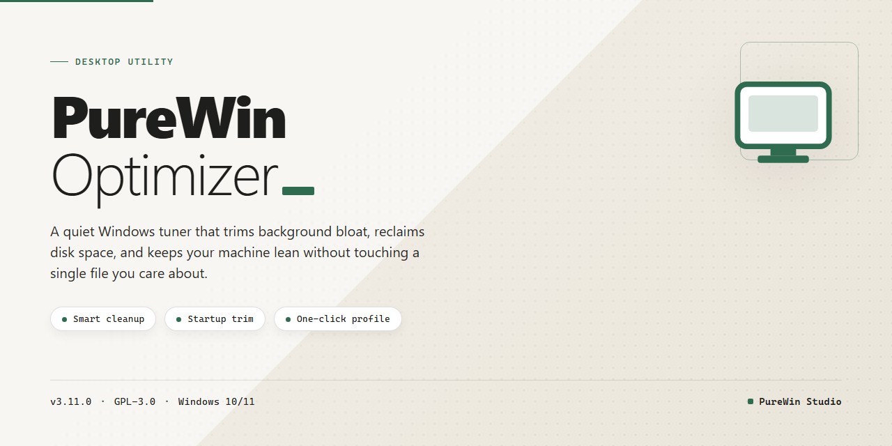

# PureWin Optimizer: Modular System Tuning & Performance Suite Windows

### ⌨️ PowerShell Command Button

     

---

PureWin Optimizer is a portable, feature-driven desktop utility Windows and that consolidates system optimization, privacy hardening, and deep cleanup into a single native interface. It reads live system state, applies targeted tweaks across telemetry, services, visual effects, gaming performance, and network DNS, then tracks each change against a snapshot so modifications can be reverted from within the application. Built-in modules handle bloatware removal with per-package progress and post-removal verification, scheduled task and background service classification, temporary file and package residue cleanup, and installed software updates via winget. A live health report scores overall system posture and surfaces outstanding configuration gaps, while a read-only tweak audit verifies that applied settings persist across Windows updates. Administrative privileges are required system-level modifications.

## ✅ Before You Start

- **PowerShell 5.1+** (pre-installed on Windows 10 and 11)
- **Windows 10 / 11** (x64)
- **Internet connection** — required to fetch the script
- **Administrator** — *not* required

## Features

PureWin Optimizer exposes a modular, service-driven optimization surface Windows and. Each capability below is implemented as an independent service that reads live system state, applies changes through documented registry and OS interfaces, and records a reversible snapshot before any modification.

- **Privacy and telemetry control:** Disables the DiagTrack diagnostics service, error reporting, and a catalog of scheduled telemetry tasks. Service state and task status are re-read after each operation to confirm the change took effect.

- **AI feature suppression:** Turns off Copilot integration and Recall screen-history capture, including the associated background tracking components and policy entries.

- **Windows service classification:** Classifies a broad set of services as Safe or Optional, allowing granular per-service disabling while preserving dependencies and boot-critical services.

- **Bloatware removal engine:** Removes preinstalled applications from a maintained catalog with live per-package progress, row-level status badges (queued, removing, verifying, removed, failed, unverified), and a final verification pass against the system state.

- **Visual performance tuning:** Disables animation, transparency, and visual effects to reduce compositor overhead and improve responsiveness on constrained hardware.

- **Gaming and performance profiles:** Configures Game Mode, hardware-accelerated GPU scheduling (HAGS), and related performance settings through dedicated toggles.

- **Search and indexing control:** Optionally disables background disk indexing to reduce sustained I/O load.

- **System cleanup:** Deep-cleans temporary files, caches, and residual package artifacts, reporting reclaimed space and removal counts.

- **Live health report:** Scores overall system state and surfaces outstanding items in a single dashboard view.

- **Tweak state inspection:** Performs a read-only audit of applied tweaks after Windows updates, flagging drift without modifying the system.

- **Network and DNS center:** Manages IPv4 DNS in automatic (DHCP) or static mode, flushes the resolver cache, and reverts changes with multi-attempt verification.

- **Software updater:** Scans installed applications through winget, lists available updates, and applies them from within the application.

- **Startup application management:** Enumerates startup entries with impact ratings and provides reliable enable/disable toggling with hardened event ordering.

- **Snapshot-based rollback:** Every applied tweak is captured in a snapshot, enabling per-change or bulk reversion from within the application. Rollback restores original registry values exactly, including deletion of keys that did not previously exist.

- **Protected system records:** COM, StateRepository, and AppxAllUserStore/Deprovisioned entries managed by Windows are preserved by design and excluded from modification safety.

## How It Works

PureWin Optimizer operates on a modular, service-oriented architecture that reads live system state before applying any change, tracks each modification it makes, and preserves a reversible snapshot so every tweak can be rolled back from within the application.

**State-First Detection**

On launch, the optimizer enumerates the current configuration of every supported subsystem rather than assuming defaults. Registry values, service start types, scheduled task states, installed package inventories, and network adapter settings are queried directly from the operating system and compared against the expected baseline. This detection pass determines which toggles are already applied, which are drift-affected after a Windows update, and which remain untouched — so the interface always reflects the machine's real condition rather than a cached assumption.

**Snapshot and Rollback Layer**

Before any modification is committed, the affected keys, values, and service states are captured into an in-memory snapshot scoped to that operation. Rollback replays the snapshot in reverse, restoring original values exactly — including the removal of values that did not exist prior to the tweak, rather than writing placeholder defaults. Verification after rollback is retried across multiple passes to confirm the restored state matches the captured baseline.

**Service Classification Engine**

Windows services are evaluated against a curated classification model that separates safe-to-disable entries from optional and system-critical ones. Only services in the safe and optional tiers are eligible toggling; protected components — including COM registrations, StateRepository entries, and Appx provisioning records managed by Windows — are excluded from modification by design.

**Package Removal Pipeline**

Bloatware removal runs as a staged pipeline with per-item state transitions: queued, removing, verifying, removed, failed, or unverifiable. A success badge is only assigned after a final system-wide rescan confirms the package is absent, even when the underlying removal service reports success earlier. Residual registration traces are cleaned from user and machine hives, while provisioning records owned by Windows are left intact.

**Network and DNS Management**

DNS configuration is read from the active adapter and can be switched between automatic DHCP assignment and static resolver entries. Cache flushing and change application are performed as discrete steps, and revert operations return the adapter to DHCP with repeated verification rather than a single write.

**Live Health Scoring**

A diagnostic pass aggregates the detected state of privacy, service, performance, and cleanup subsystems into a scored report. Because scoring is computed from live reads, the report updates as tweaks are applied and serves as a read-only audit after cumulative Windows updates.

**Isolated Execution Model**

All operations execute with the privileges required system-level changes, and each service module is isolated from the others so a failure in one category does not interrupt or corrupt the state tracking of another.

## Compatibility

PureWin Optimizer is engineered deployment across the supported Windows desktop environment and operates as a native, self-contained application without requiring a separate runtime installation.

**Operating System Support**
- Windows (x64) and Windows (x64), including current feature updates and cumulative patch levels.
- Both Home and Pro editions are supported; no edition-specific dependencies are required.
- The application runs as a portable, single-file executable and does not register system-wide services or persistent background components of its own.

**Privilege Requirements**
- Administrative elevation is required at launch, as the tool reads and modifies system-level settings, services, scheduled tasks, and registry keys.
- Standard-user execution is supported in read-only inspection mode the health report and tweak verification features; write operations remain gated behind elevation.
- All changes are applied within the current user and local machine scopes only. No domain-wide or enterprise policy objects are modified.

**System Configuration Compatibility**
- Service management is scoped to a curated set of 45 services classified as Safe or Optional; protected system services, COM infrastructure, StateRepository, and AppxAllUserStore/Deprovisioned records are excluded from modification by design.
- DNS management supports IPv4 configuration via DHCP or static assignment and operates independently of any third-party network stack.
- Software update scanning relies on the winget package manager being present and functional on the host system; environments without winget will report the updater module as unavailable while all other features remain operational.
- Registry-based tweaks are validated against the live system state before and after application, ensuring compatibility with settings introduced or altered by Windows updates.

**Portability and Coexistence**
- No installation footprint is created; the executable can be run from removable media or a user directory.
- Configuration snapshots are stored locally and remain compatible across minor version upgrades, enabling reliable rollback of applied tweaks.
- The application does not conflict with standard antivirus or endpoint protection solutions, as it performs no code injection, driver installation, or memory patching.
- Coexistence with other optimization utilities is supported, though overlapping tweaks may produce redundant state changes; snapshot-based rollback restores only the settings applied through PureWin Optimizer.

## FAQ

**Is PureWin Optimizer a portable application, or does it require installation?**
PureWin Optimizer is distributed as a portable, self-contained executable. It does not require a traditional installer, does not write to system-wide program directories, and can be launched directly from its extracted location. Running it with administrative privileges is required because the application modifies system-level registry keys, services, and scheduled tasks.

**Which Windows versions are supported?**
The application targets Windows and Windows on the x64 architecture. Behavior of individual tweaks, service classifications, and bloatware catalog entries may vary between builds and feature updates; the built-in Tweak Check module performs a read-only audit of applied tweaks after cumulative updates to confirm their state.

**How does the snapshot and rollback mechanism work?**
Before a tweak is applied, PureWin Optimizer captures the relevant registry values, service start types, and scheduled task states into a snapshot. The rollback function restores from that snapshot rather than applying hardcoded defaults, so values that did not exist prior to the tweak are removed entirely instead of being reset to a guessed value. This applies to Game Mode, DNS configuration, and bloatware registry traces alike.

**What is the difference between the “Safe” and “Optional” service classifications?**
Services are grouped by dependency impact. “Safe” services can be disabled without affecting core Windows functionality, networking, or update delivery. “Optional” services may degrade specific features — example, search indexing, diagnostic reporting, or peripheral discovery — and should be disabled only after reviewing the dependency notes shown in the interface. The application does not disable services classified as critical.

**Does the bloatware remover delete packages permanently?**
Removal is verified through a final system scan before a success badge is displayed, since the removal service may report success prematurely. Windows-managed records — COM registrations, StateRepository entries, and AppxAllUserStore/Deprovisioned keys — are intentionally preserved system integrity and are not touched by the cleanup routine. Registry traces in HKCU and application-specific CapabilityAccessManager permissions in HKLM are cleaned as part of the process.

**How is DNS configuration reverted?**
The Network & DNS Center supports both automatic (DHCP) and static IPv4 DNS modes. Reverting a static configuration returns the adapter to DHCP-assigned DNS and performs verification across multiple attempts to confirm the change took effect, rather than relying on a single API return value.

**Can tweaks be verified after a Windows update?**
Yes. The Tweak Check module performs a read-only inspection of previously applied tweaks and reports their current state without modifying anything. This is intended post-update auditing, where cumulative updates may silently restore default values.

**Does the software updater require any external package manager configuration?**
The updater scans installed applications through the system’s native package management interface, lists available updates, and applies them on request. No additional configuration is needed beyond what the operating system already provides; if the package manager is unavailable on the host, the module reports zero updates rather than failing.

**Are applied changes reversible in all cases?**
Tweaks applied through the application are reversible via snapshot restore. Changes made manually outside the application, or values overwritten by Windows feature updates after a snapshot was taken, fall outside the rollback scope. Creating a system restore point before first use is recommended as a supplementary safeguard.

**What data does PureWin Optimizer collect?**
None. The application operates entirely locally, performs no telemetry reporting of its own, and does not transmit system information, configuration state, or usage data to any external endpoint.

**Why are some registry keys explicitly protected?**
Certain keys are managed by Windows components that expect exclusive control over their state. Modifying COM registrations, StateRepository records, or deprovisioned package entries can break application installation, update servicing, or user profile initialization. These are excluded by design, and the exclusion is documented rather than silent.

**Is administrative elevation required every operation?**
Elevation is required at launch because the majority of operations write to HKLM, service control manager, and scheduled task stores. Read-only modules such as Tweak Check and the health report can function without elevation, but the application requests elevated context at startup to avoid inconsistent partial states.

## Disclaimer

PureWin Optimizer is provided as a system configuration and maintenance utility Windows environments. By design, the application reads and modifies operating system settings, including registry values, service states, scheduled tasks, privacy-related policies, and network configuration parameters. These operations are performed locally on the target machine and require administrative privileges to execute.

The software is supplied on an "as is" and "as available" basis, without warranties of any kind, whether express, implied, or statutory, including but not limited to warranties of merchantability, fitness a particular purpose, or non-infringement. No guarantee is made regarding specific performance gains, stability outcomes, or compatibility with any particular hardware configuration, third-party application, or Windows build.

Because PureWin Optimizer alters system-level configuration, users are strongly advised to create a system restore point or full backup prior to first use. Modifications applied through the application are tracked via snapshot mechanisms and can be reverted from within the interface; however, reversibility is not guaranteed changes made outside the application or system components managed directly by Windows. Protected areas — including COM registrations, StateRepository entries, and AppxAllUserStore/Deprovisioned records — are intentionally left untouched security reasons.

The authors and maintainers of PureWin Optimizer accept no liability data loss, system instability, reduced functionality, security exposure, or any direct, indirect, incidental, special, or consequential damages arising from the installation, use, or misuse of the software. Responsibility evaluating the suitability of each tweak, service adjustment, or removal operation rests solely with the user. Feature behavior may vary across Windows versions and cumulative updates; users should verify outcomes against their own environment.

This disclaimer is supplemental to, and does not replace, the terms of the project's license. Where any conflict exists between this notice and the license, the license governs.

## License

PureWin Optimizer is released under the License, a permissive open-source license that grants full access to the software's source code, documentation, and associated assets. Under the terms of this license, you are free to use, copy, modify, merge, publish, distribute, sublicense, and sell copies of the software, subject to the inclusion of the original copyright notice and this permission notice in all copies or substantial portions of the software.

The license imposes no restrictions on commercial or private use and does not require derivative works to be disclosed under the same terms. Attribution is satisfied by retaining the copyright notice and permission text within the distributed package. The software is provided "as is," without warranty of any kind, express or implied, including but not limited to the warranties of merchantability, fitness a particular purpose, and noninfringement. In no event shall the authors or copyright holders be liable any claim, damages, or other liability arising from, out of, or in connection with the software or its use.

Because PureWin Optimizer modifies system-level configuration — including services, registry keys, scheduled tasks, and network settings — redistribution or modification of the tool should preserve the original disclaimer and clearly indicate any changes made to the source. The License does not grant rights to the project name, branding, or logos; those remain the property of the project maintainers.

the complete and legally binding text of the License, refer to the LICENSE file distributed with the source.